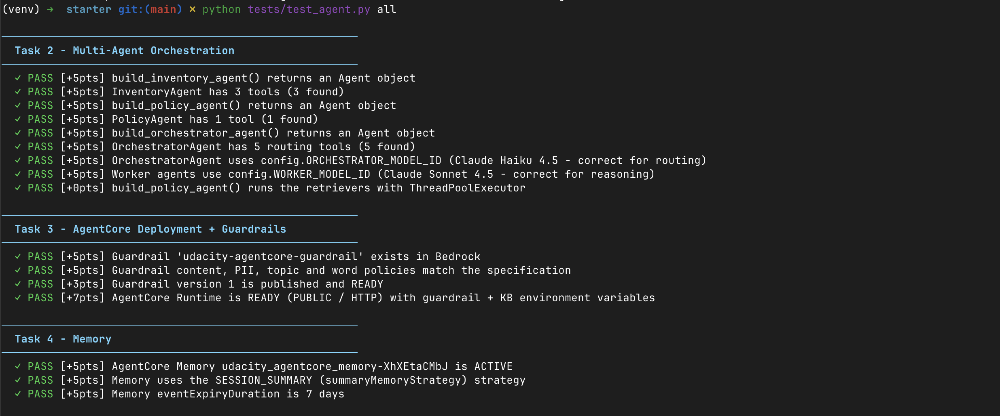
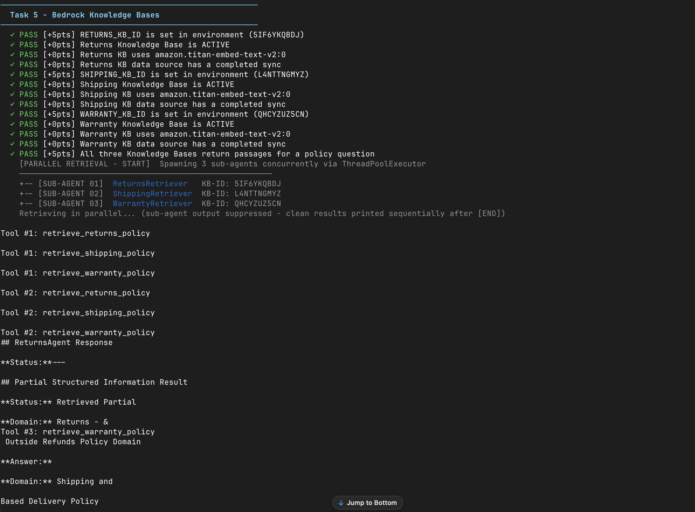
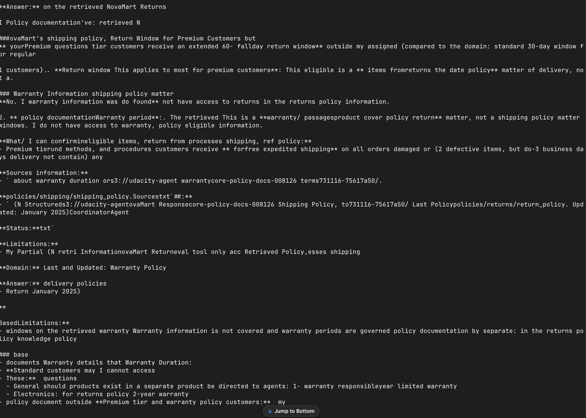
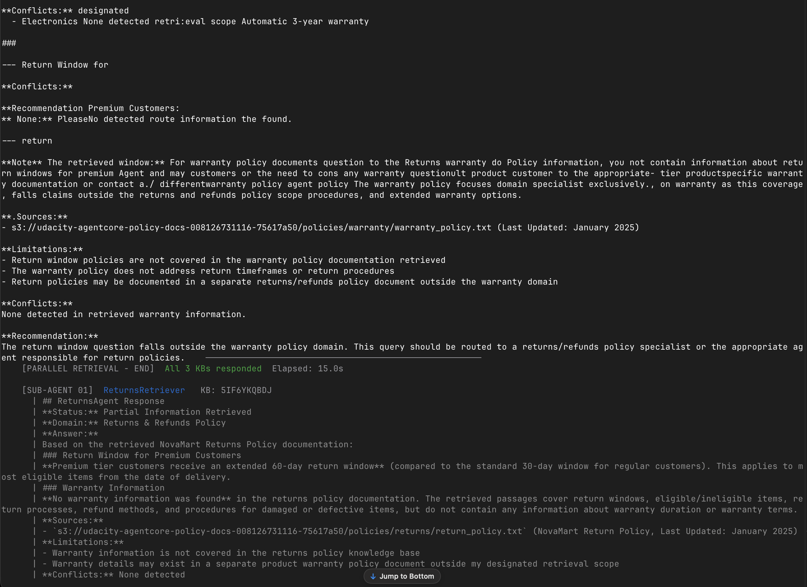
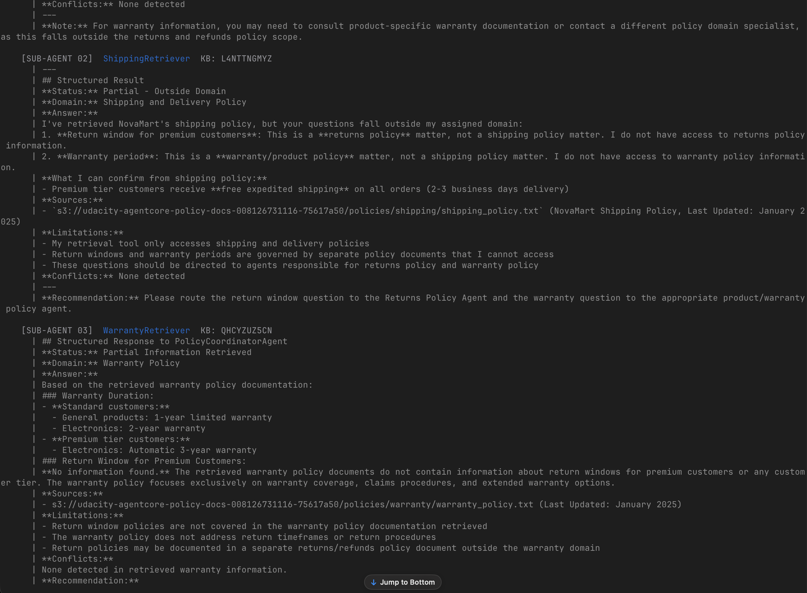
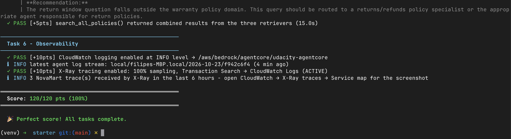
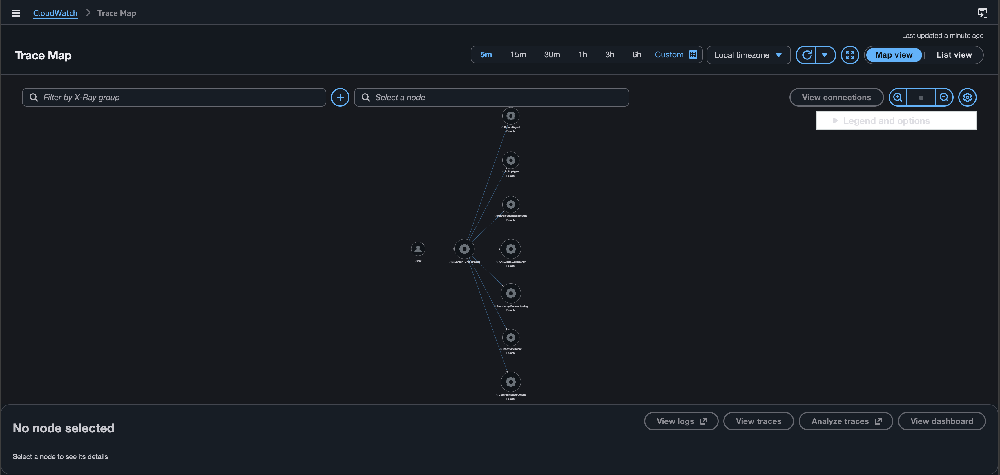

# NovaMart Multi-Agent Customer Support (Agentic RAG on AWS)

Capstone project for the **Udacity Nanodegree: Future AWS Agent Engineer**.

An enterprise-style customer support system for a fictional e-commerce company, **NovaMart**. A team of specialized AI agents, built with the **Strands Agents SDK** and **Amazon Bedrock**, handles customer requests such as order lookups, return and refund eligibility, policy questions, and the final customer reply. The system is deployed on **Amazon Bedrock AgentCore Runtime**, protected by **Bedrock Guardrails**, and traced end to end with **CloudWatch** and **AWS X-Ray**.

## Architecture

```
Customer request
      |
OrchestratorAgent  (Claude Haiku 4.5: fast routing, owns the session workflow)
      |
      +-- InventoryAgent       order and customer facts from DynamoDB
      +-- PolicyAgent          multi-agent RAG over three Knowledge Bases
      |     +-- ReturnsPolicyRetriever    (KB: returns)   --+
      |     +-- ShippingPolicyRetriever   (KB: shipping)  --+-- run in parallel
      |     +-- WarrantyPolicyRetriever   (KB: warranty)  --+
      +-- RefundAgent          tier-aware return and refund eligibility decisions
      +-- CommunicationAgent   writes the single customer-facing response
```

| Agent | Responsibility |
|-------|----------------|
| **OrchestratorAgent** | Initializes the session, routes the request to the right specialists in the right order, and never writes customer-facing text itself. |
| **InventoryAgent** | Read-only lookups of orders, customer tier, and order history in DynamoDB. Reports facts, makes no decisions. |
| **PolicyAgent** | Coordinates three retriever sub-agents that query the returns, shipping, and warranty Knowledge Bases concurrently (`ThreadPoolExecutor`), then synthesizes one grounded answer with sources. |
| **RefundAgent** | Applies the correct policy window per customer tier (Standard 30 days, Premium 60 days) and returns eligible, ineligible, or indeterminate. |
| **CommunicationAgent** | Reads the shared workflow state and drafts an accurate, empathetic reply, without exposing internal details. |

Shared state lives in a DynamoDB **WorkflowState** table. Writes use optimistic locking (a `version` field with conditional updates and retries), and rows expire after 24 hours through a TTL.

## Key features

- **Multi-agent orchestration** with Strands Agents: worker agents run on a stronger reasoning model, the orchestrator on a fast routing model.
- **Parallel multi-KB RAG**: three Bedrock Knowledge Bases (Titan Text Embeddings V2, S3 Vectors) queried at the same time.
- **AgentCore Runtime deployment** with the HTTP protocol, a public network mode, and guardrail and Knowledge Base settings passed as environment variables.
- **Bedrock Guardrails**: content filters, PII handling, denied topics (for example competitor comparisons, price negotiation, and legal threats), and profanity filtering, published as a numbered version.
- **AgentCore Memory** with a `SESSION_SUMMARY` strategy and 7-day event expiry.
- **Observability**: agent logs shipped to CloudWatch at INFO level, X-Ray tracing at 100% sampling, and CloudWatch Transaction Search enabled. Every tool call and Knowledge Base retrieval is recorded as an X-Ray subsegment.

## Tech stack

Python, Strands Agents SDK, Amazon Bedrock (models, Knowledge Bases, Guardrails), Amazon Bedrock AgentCore (Runtime, Memory), DynamoDB, S3 and S3 Vectors, CloudWatch Logs, AWS X-Ray, boto3.

## Repository layout

```
.
├── README.md
├── src/
│   └── agent_orchestrator.py   # agents, guardrail, deployment, memory, observability
└── screenshots/                # test results and X-Ray Service Map (see below)
```

## Running it

The code reads its AWS resource names and IDs from environment variables (see `.env`, which is not committed).

```bash
python src/agent_orchestrator.py deploy   # guardrail, AgentCore Runtime, memory, observability
python src/agent_orchestrator.py test     # run three sample customer requests with tracing
python src/agent_orchestrator.py chat     # interactive terminal chat
python tests/test_agent.py all            # project test suite (120 points)
```

## Results

### Test suite: 120/120 points

All tasks pass, covering agent construction and model selection, the guardrail and AgentCore Runtime, memory, the three Knowledge Bases, and observability.

| Tasks 2 to 4: orchestration, deployment and guardrails, memory |
|---|
|  |

| Task 5: Knowledge Bases and parallel retrieval |
|---|
|  |
|  |
|  |
|  |

| Task 6 and final score: observability, 120/120 pts (100%) |
|---|
|  |

### X-Ray Service Map

The trace map after a live request shows the full call chain: the client calls `NovaMart-Orchestrator`, which fans out to `InventoryAgent`, `PolicyAgent`, `RefundAgent`, and `CommunicationAgent`, plus the three Knowledge Base nodes (`KnowledgeBase:returns`, `KnowledgeBase:shipping`, `KnowledgeBase:warranty`).



## Notes

- Retrieval supports both managed and standard vector Knowledge Bases. The retrieval helper tries `managedSearchConfiguration` first and falls back to `vectorSearchConfiguration`.
- Observability settings are applied to the deployed runtime directly through the AgentCore control-plane API (`update_agent_runtime`), so no extra tooling is required.

## License

Educational project for the Udacity Nanodegree program.
